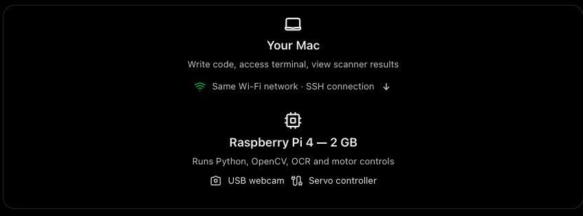

## 1. Host, Username, password
Hostname: pokemon-sorter
Username: sorter
Password: a strong password of your choice
Wi-Fi: your home network and password
Remote Access: enable SSH with password authentication

## 2. Connect from your Mac

Insert the prepared microSD card into the Raspberry Pi and plug its power supply into the wall.

Once it finishes starting up and connects to your Wi-Fi, open Terminal on your Mac and type:
`ssh sorter@pokemon-sorter.local`

Enter the password you configured.

If everything works, you'll be controlling your Raspberry Pi directly from your Mac.

Then run:
```
sudo apt update
sudo apt full-upgrade -y
```

If the .local hostname cannot be resolved, we can look up the Pi's local IP address in your router and connect that way.

## 3. CONFIGURE CAMERA
